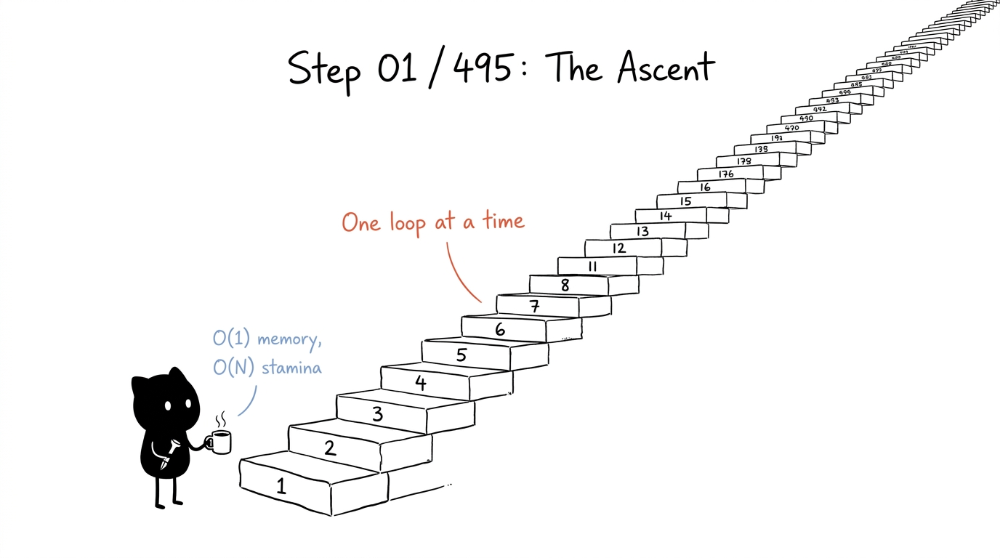

# 🚀 Striver's A2Z DSA Sheet — Java Solutions

[](https://www.java.com/)
[](https://takeuforward.org/strivers-a2z-dsa-course/strivers-a2z-dsa-course-sheet-2/)
[](#-progress-tracker)
[](LICENSE)

<p align="center">
  
</p>

A clean, structured repository tracking my complete journey through **[Striver's A2Z DSA Sheet](https://takeuforward.org/strivers-a2z-dsa-course/strivers-a2z-dsa-course-sheet-2/)** by **Raj Vikramaditya (Striver)**.

Every solution is implemented in **Java**, focusing on clean code, thorough documentation, and analyzing **Time & Space Complexities** across Brute Force, Better, and Optimal approaches.

---

## 📌 Repository Structure

```text
├── 01-learn-the-basics/
├── 02-sorting-techniques/
├── 03-arrays/
├── 04-binary-search/
├── 05-strings/
├── 06-linked-list/
├── 07-recursion/
├── 08-bit-manipulation/
├── 09-stacks-and-queues/
├── 10-sliding-window-and-two-pointer/
├── 11-heaps/
├── 12-greedy-algorithms/
├── 13-binary-trees/
├── 14-binary-search-trees/
├── 15-graphs/
├── 16-dynamic-programming/
├── 17-tries/
├── 18-advanced-strings-and-algorithms/
├── templates/
│   └── SolutionTemplate.java
└── docs/
    └── POST_TEMPLATES.md
```

---

## 📊 Progress Tracker

| Step | Topic | Status | Folder Link |
| :---: | :--- | :---: | :--- |
| **01** | **Learn the Basics** (Syntax, Patterns, Math, Recursion, Hashing) | ⏳ In Progress | [01-learn-the-basics](./01-learn-the-basics) |
| **02** | **Important Sorting Techniques** (Selection, Bubble, Insertion, Merge, Quick) | ⬜ Pending | [02-sorting-techniques](./02-sorting-techniques) |
| **03** | **Solve Problems on Arrays** (Easy, Medium, Hard) | ⬜ Pending | [03-arrays](./03-arrays) |
| **04** | **Binary Search** (1D Arrays, Answers, 2D Arrays) | ⬜ Pending | [04-binary-search](./04-binary-search) |
| **05** | **Strings** (Basic and Medium) | ⬜ Pending | [05-strings](./05-strings) |
| **06** | **LinkedList** (Single, Doubly, Medium, Hard) | ⬜ Pending | [06-linked-list](./06-linked-list) |
| **07** | **Recursion** (Strong Hold, Subsequences, Hard Problems) | ⬜ Pending | [07-recursion](./07-recursion) |
| **08** | **Bit Manipulation** (Basics, Interview Problems, Advanced Math) | ⬜ Pending | [08-bit-manipulation](./08-bit-manipulation) |
| **09** | **Stacks & Queues** (Learning, Monotonic, Implementations) | ⬜ Pending | [09-stacks-and-queues](./09-stacks-and-queues) |
| **10** | **Sliding Window & Two Pointer** (Medium, Hard) | ⬜ Pending | [10-sliding-window-and-two-pointer](./10-sliding-window-and-two-pointer) |
| **11** | **Heaps / Priority Queue** (Learning, Medium, Hard) | ⬜ Pending | [11-heaps](./11-heaps) |
| **12** | **Greedy Algorithms** (Easy, Medium/Hard) | ⬜ Pending | [12-greedy-algorithms](./12-greedy-algorithms) |
| **13** | **Binary Trees** (Traversals, Medium, Hard) | ⬜ Pending | [13-binary-trees](./13-binary-trees) |
| **14** | **Binary Search Trees** (Concepts, Practice) | ⬜ Pending | [14-binary-search-trees](./14-binary-search-trees) |
| **15** | **Graphs** (BFS/DFS, Topo Sort, Shortest Path, MST/Disjoint Set) | ⬜ Pending | [15-graphs](./15-graphs) |
| **16** | **Dynamic Programming** (1D, Grids, Subsequences, Strings, Stocks, LIS, MCM) | ⬜ Pending | [16-dynamic-programming](./16-dynamic-programming) |
| **17** | **Tries** (Theory & Implementations) | ⬜ Pending | [17-tries](./17-tries) |
| **18** | **Advanced Strings & Algorithms** (KMP, Z-Algorithm, Manacher's) | ⬜ Pending | [18-advanced-strings-and-algorithms](./18-advanced-strings-and-algorithms) |

---

## 💻 Code Standards & Template

Every solution file follows a consistent standard with Javadoc header comments detailing:
- Problem Name & Original Link
- Intuition & Algorithm Breakdown
- Time Complexity ($O(...)$) & Space Complexity ($O(...)$)
- Clean, readable Java implementation

See [`templates/SolutionTemplate.java`](./templates/SolutionTemplate.java) for the starter blueprint.

---

## 📢 Sharing Milestones

Check out [`docs/POST_TEMPLATES.md`](./docs/POST_TEMPLATES.md) for ready-made templates for LinkedIn, Twitter/X, and tech blogs to share milestone updates as each step is completed.

---

## 🤝 Acknowledgements

- **Raj Vikramaditya (Striver)** for designing the comprehensive [takeUforward A2Z Sheet](https://takeuforward.org).
- The global coding community on LeetCode, CodeStudio, and GFG.
